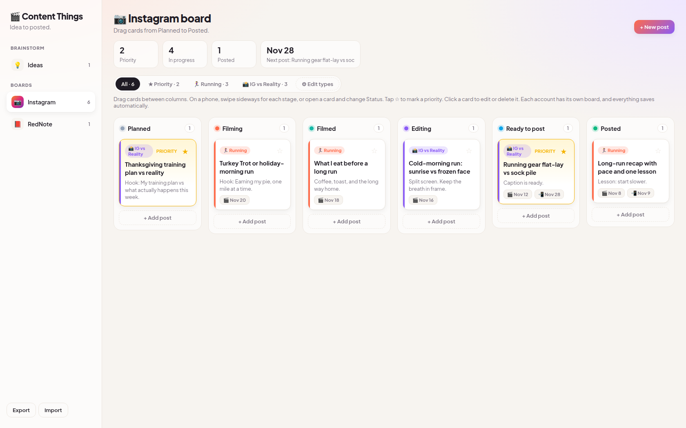

# Content Things

A single-page tracker for content creators. Capture ideas, then move posts from planned to posted — filming, editing, and the steps in between. You start with an Instagram board and can add any platform you actually use.

## Use it

Open **[Content Things](https://ichiewang96.github.io/content-management/)**. No sign-up and no install required.

Your ideas and boards stay private in your own browser, on that device. Nothing is sent to a server. Clearing the browser's site data erases them, so export a backup regularly.

In the sidebar, choose **Add platform** to create another board. Pick a preset (TikTok, YouTube, RedNote, X, Facebook) or type your own name and emoji. Each platform has its own posts and content types. Open a board and choose **Edit board** to rename it, or to delete it. Deleting a board that already has posts asks you to confirm, because those posts are removed with it.

Use **Export** in the sidebar to download a backup, and **Import** to restore it. Export before you clear browser data, switch browsers, or move to a new phone — that file is the only copy outside this browser. Older backups that only contain Instagram and RedNote still import.

On a phone, add the page to your home screen (browser menu → **Add to Home Screen**) and it opens like an app.

## Make your own version

1. Sign in to GitHub and open [this repository](https://github.com/ichiewang96/content-management).
2. Click **Fork** and create the fork under your account.
3. In your fork, open **Settings → Pages**.
4. Under **Build and deployment**, set **Source** to **Deploy from a branch**.
5. Choose branch **main** and folder **/ (root)**, then save.
6. After a minute or two, your copy is at `https://YOUR-USERNAME.github.io/content-management/`.

The app is the single file `index.html`, plus a small icon and manifest so phones can install it. Edit `index.html` directly — there is no build step. People who open your copy keep their own data in their own browser.

## License

[MIT](LICENSE) © 2026 ichiewang96
